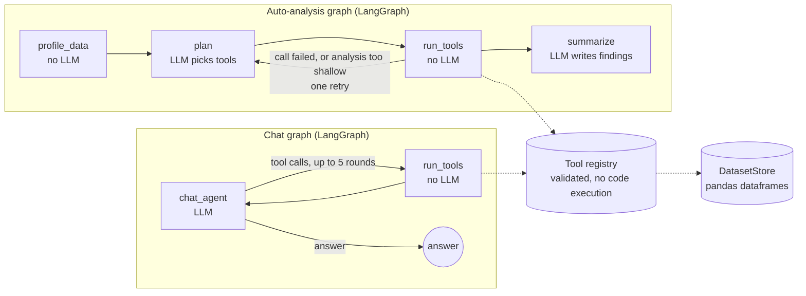

# AI Data Analysis Agent

Upload a CSV or Excel file and the agent profiles it, proposes cleaning (you approve every change), runs an analysis with charts, and answers questions about the data in plain English.

**The model never does the maths.** Every number in an answer comes from a validated pandas tool; the model only chooses which tool to call and explains the result.

<!-- Add a screenshot or GIF of the app here: docs/demo.gif -->
<!-- Live demo: https://YOUR-APP.streamlit.app -->

## What it does

| Tab | What happens |
|---|---|
| **Overview** | Shape, column types, missing values, duplicates and data-quality issues. No LLM involved. |
| **Clean** | Proposes fixes (fill gaps, convert types, drop sparse columns, remove duplicates). Nothing changes until you tick fixes and apply them. The original upload is always kept and can be restored. |
| **Auto-analysis** | The agent picks analyses and charts, runs them, and writes findings and follow-up questions. |
| **Chat** | Ask questions such as *"What was the survival rate for women in first class?"* The answer shows the tools that produced it. |

## How it works



Design rules that make the answers trustworthy:

- **The LLM never sees your data**, only a compact profile (column names, types, counts) and tool results.
- **The LLM never does arithmetic.** Means, rates, correlations and outliers are computed by pandas tools.
- **No arbitrary code execution.** The model can only call five typed tools: `describe_stats`, `correlation_analysis`, `detect_outliers`, `group_aggregate` and `create_chart`. Arguments are validated with Pydantic, unknown arguments are rejected, and every error comes back with a hint the model can use to retry.
- **The model cannot change your data.** Cleaning tools are not exposed to the model. Fixes are proposed to you and applied only after you approve them.
- **Every step is traced.** The UI shows which tools ran, with which arguments, and what they returned.
- **Failures degrade gracefully.** A tool error gets one retry with the error message. If no analysis succeeds, the agent says so instead of inventing findings. Rate-limited or busy Gemini calls retry with backoff.

## Evaluation

The agent is checked with a 19-question eval on the Titanic data (`python -m eval.run_eval data/titanic.csv`). The correct answers are computed from the file with pandas at run time, and an answer passes only if it contains the right numbers and the right tool ran. Two questions the data cannot answer (a price on Mars, passenger salaries) pass only if the agent says so.

- **Result:** 19/19 on the latest run. Full table: [`eval/RESULTS.md`](eval/RESULTS.md).
- **History:** the first run scored 18/19. The miss (survival rate of children under 10) exposed a design gap: the grouping tool required a group-by column, so the agent could not ask for one overall number about a subset. Fixing the tool, not the test, brought it to 19/19.
- **Limits:** 19 questions on one dataset, and model answers vary between runs, so treat it as a regression check, not a benchmark.

## Run it locally

```bash
git clone <this repo>
cd <repo>
python -m venv .venv
.venv\Scripts\activate          # macOS/Linux: source .venv/bin/activate
pip install -r requirements.txt
cp .env.example .env            # then paste your free key from https://aistudio.google.com/apikey

streamlit run app.py            # the app
python run_auto.py data/titanic.csv     # auto-analysis in the terminal
python chat_cli.py data/titanic.csv     # chat in the terminal
python -m pytest tests -q               # tests (no API calls needed except the live smoke test)
python -m eval.run_eval data/titanic.csv   # the eval (about 4 minutes on the free Gemini tier)
```

The eval paces its model calls to stay under the free-tier rate limit (`--rpm`, default 12) and `--failed` re-runs only the cases that failed.

## Project layout

```
app.py                  Streamlit app
run_auto.py, chat_cli.py   terminal runners
config.py               limits and model name
src/
  loader.py             safe CSV/Excel loading (50 MB cap) and the dataset store
  schemas.py            ToolResult and shared types
  tools/                profile, cleaning, stats, group_aggregate, charts + registry
  agent/                LangGraph graphs, nodes, prompts, Gemini client with retry
eval/                   19-question eval, scoring and rate limiter
tests/                  unit, graph (scripted fake LLM), app (Streamlit AppTest) tests
```

## Stack

Python, pandas, NumPy, Plotly, Pydantic, LangChain, LangGraph, Gemini (free API), Streamlit, pytest, GitHub Actions.

## Known limits

- Files up to 50 MB; the whole dataset is held in memory.
- Chat history lives in the browser session and is lost on refresh.
- Analyses are descriptive (statistics, groups, correlations, outliers). It does not fit predictive models.
- The free Gemini tier is rate-limited, so heavy use may show a "busy" message.
